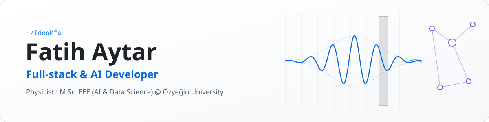

<picture>
  <source media="(prefers-color-scheme: dark)" srcset="assets/banner-dark.svg">
  
</picture>

  
  

I'm a physicist and a software developer. I build full-stack products and AI systems, from data pipelines and dashboards to LLM agents that do real work. I studied physics at Istanbul University and I'm now doing an M.Sc. in Electrical & Electronics Engineering at Özyeğin University, focused on AI and data science, where I also teach physics labs as a teaching assistant.

What I care about: tools people actually use every day, numbers I can verify, and systems that stay understandable after the demo.

## Now

| | |
|---|---|
| **Masek** · *C++ / Qt, Claude Code* | A desktop "second brain": notes, day planning, meeting recording and transcription, all driven by AI agents running locally on top of Claude Code. In-app approvals, vault snapshots with undo, macOS and Linux builds in CI. |
| **Socratic Learning Environment** · *Next.js, Supabase, LLMs* | Founding engineer at an early-stage startup (three-person team): an AI tutor that teaches by asking questions instead of handing out answers, with knowledge tracing to follow each student's progress. |
| **Craft Beverage Studio** · *Next.js, TypeScript* | For Creative F&B, a Swiss beverage developer: an AI-assisted platform where brands request custom drinks, and the design of a deterministic recipe engine that turns a brief into a technical formulation. |

*These repositories are private; happy to walk through them.*

## Selected open-source work

| Project | What it is |
|---|---|
| [**OpenScope**](https://github.com/IdeaMfa/OpenScope) | Cross-platform desktop app for microscopy image analysis (Python, PyQt6, OpenCV). Plugin architecture, consensus-voting bacteria detector, 16-bit TIFF support, CI builds. |
| [**Quantum tunneling simulation**](https://github.com/IdeaMfa/Quifu2024QuantumTunnelingSimulation) | 1D time-dependent Schrödinger equation solved with Crank–Nicolson; animated wave packets hitting potential barriers. The wave in the banner above is a nod to it. |
| [**Student Tracking System**](https://github.com/IdeaMfa/OrsaDemoStudentTracking) | Full-stack ASP.NET Core + Entity Framework app with authentication and CRUD for student profiles, split into [models](https://github.com/IdeaMfa/OrsaDemoModels), [Web API](https://github.com/IdeaMfa/OrsaDemoWebApi) and [web app](https://github.com/IdeaMfa/OrsaDemoWebApp). |
| [**C++ toolbox**](https://github.com/IdeaMfa/cpp-benchmark-lite) | Small libraries for practising modern C++: a header-only [benchmark](https://github.com/IdeaMfa/cpp-benchmark-lite) library, a templated [vector](https://github.com/IdeaMfa/MyVector) with manual memory management, a CMake [2D vector library](https://github.com/IdeaMfa/Vec2Lib-cpp). |
| [**Moview**](https://github.com/IdeaMfa/projectMoview) | Flask web app for sharing comments on movies, backed by the OMDb API. |
| [**X (Twitter) scraper**](https://github.com/IdeaMfa/Twitter-X-ScrapingProject) | Selenium + PostgreSQL pipeline that collects posts and media into a database. |
| [**Feature engineering, end to end**](https://github.com/IdeaMfa/EndToEnd-Feature-Engineering-Model) | Data cleaning, feature extraction and a baseline model, written up as a learning project. |

## Toolbox

  

**Also:** PyQt6 · OpenCV · NumPy · Entity Framework · Selenium · CMake · GitHub Actions · Vercel · Claude Code and the Claude API · local speech-to-text with whisper.cpp

## Background

- **M.Sc. Electrical & Electronics Engineering**, Özyeğin University, focus on AI and data science (in progress)
- **Teaching Assistant**, physics laboratories (PHYS 101L / 102L), Özyeğin University
- **Founding Engineer**, Socratic Learning Environment
- **B.Sc. Physics**, Istanbul University, 2015
